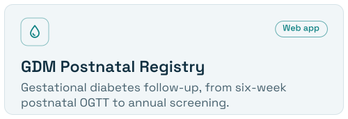
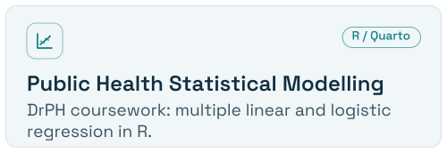

<picture>
  <source media="(prefers-color-scheme: dark)" srcset="assets/banner-dark.svg">
  
</picture>

  <a href="https://my.linkedin.com/in/muhammad-ruhaifi-m-s-8b70b736b"><picture><source media="(prefers-color-scheme: dark)" srcset="assets/links/linkedin-dark.svg"></picture></a>
  <a href="https://orcid.org/0009-0003-0956-0143"><picture><source media="(prefers-color-scheme: dark)" srcset="assets/links/orcid-dark.svg"></picture></a>
  <a href="https://scholar.google.com/citations?user=Rnm1yEIAAAAJ"><picture><source media="(prefers-color-scheme: dark)" srcset="assets/links/googlescholar-dark.svg"></picture></a>
  <a href="https://www.researchgate.net/profile/Muhammad-Ruhaifi-Muhammad-Sabri"><picture><source media="(prefers-color-scheme: dark)" srcset="assets/links/researchgate-dark.svg"></picture></a>

Medical Officer at the [Tumpat District Health Office](https://jknkelantan.moh.gov.my/), Kelantan, [Ministry of Health Malaysia](https://www.moh.gov.my/), and Doctor of Public Health (DrPH) candidate at [Universiti Sains Malaysia (USM)](https://www.usm.my/). 
MD (UKM) · MPH (USM) · OHD (DOSH) · Google Gemini Certified Educator

## Now

**AI-SAFER:** current research on an AI-enhanced, scenario-based simulation for flood preparedness training.

## Selected Projects

  <a href="https://github.com/ruhaifimd/GDM-Postnatal-Registry"><picture><source media="(prefers-color-scheme: dark)" srcset="assets/cards/gdm-dark.svg"></picture></a>
  <a href="https://github.com/ruhaifimd/Kursus-Generatif-AI"><picture><source media="(prefers-color-scheme: dark)" srcset="assets/cards/genai-dark.svg"></picture></a>
  <a href="https://github.com/ruhaifimd/Program-Registry-System"><picture><source media="(prefers-color-scheme: dark)" srcset="assets/cards/registry-dark.svg"></picture></a>
  <a href="https://github.com/ruhaifimd/Multiple-Logistic-Regression_DrPH"><picture><source media="(prefers-color-scheme: dark)" srcset="assets/cards/stats-dark.svg"></picture></a>

Statistical Modelling repositories: <a href="https://github.com/ruhaifimd/Multiple-Linear-Regression_DrPH">linear regression</a> · <a href="https://github.com/ruhaifimd/Multiple-Logistic-Regression_DrPH">logistic regression</a>

## Selected Presentations & Recognition

<b>Prompt to Application: Smarter Healthcare Apps with Generative AI</b> 
Pasir Puteh District Health Office, Kelantan · Oct 2026 · <a href="https://github.com/ruhaifimd/ruhaifimd/blob/main/slides/2026-10-prompt-to-application-ruhaifi.pdf">PDF&nbsp;slides</a>&nbsp; 

<b>Empower Remaja di Sebalik Ombak: adolescent sexual &amp; reproductive health programme evaluation</b> 
Kelantan State-Level Panel Penasihat Klinik Kesihatan (Health Clinic Advisory Panel) Convention · Oct 2026&nbsp; 

<b>Explorace adolescent sexual &amp; reproductive health programme: student knowledge, Tumpat</b> 
3rd East Coast Research Day 2026, Kuantan · Sep 2026&nbsp; 

<b>Commuting injury among MOH staff in Kelantan, 2016–2022</b> 
27th NIH Scientific Conference 2026, Selangor · Jul 2026&nbsp; 

<b>Beyond the Bench: Public Health Laboratories and Generative AI</b> 
Kota Bharu Public Health Laboratory, Kelantan · Jun 2026 · <a href="https://github.com/ruhaifimd/ruhaifimd/blob/main/slides/2026-06-beyond-the-bench-ruhaifi.pdf">PDF&nbsp;slides</a>&nbsp; 

## Publications

Ku et al. (2014). The harmful effects of consumption of repeatedly heated edible oils: a short review. *La Clinica Terapeutica*. [PMID:25203337](https://pubmed.ncbi.nlm.nih.gov/25203337/) · [More on Google Scholar](https://scholar.google.com/citations?user=Rnm1yEIAAAAJ)

Open to conversations on public health research, AI education for health staff and simulation-based disaster preparedness.

Selected themes, not the full scope of my work. Repositories share software and learning materials; listing them does not establish clinical validation or suitability for identifiable health data. Please do not share patient information.
